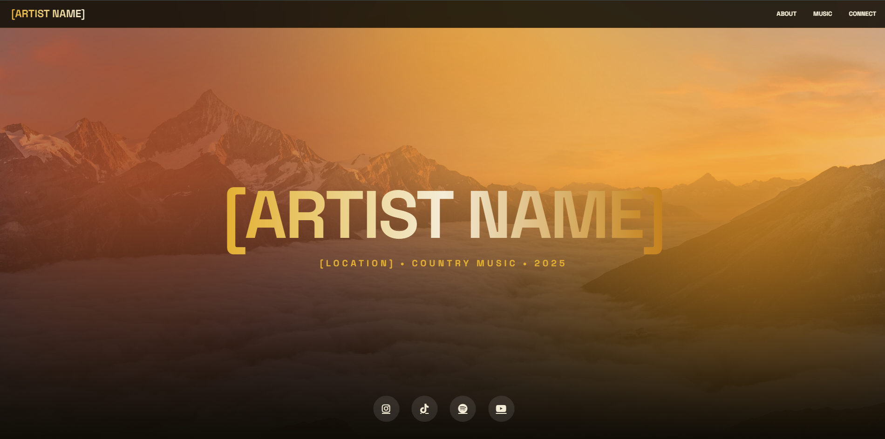

# Music Website



**Live Demo:** [View the Music Website](https://music-website-for-an-artist-called.vercel.app/)

## Overview

The Music Website is a promotional website for SIBS, a Johannesburg-based rapper. The website is designed to showcase the artist's music, identity, biography and contact information through a modern, visually engaging interface.

The project focuses on responsive web design, custom styling, animated visual effects and an accessible layout that allows visitors to discover the artist and explore their music.

## Features

- Artist-focused hero section with animated lighting effects
- Custom artist branding and visual styling
- About section for introducing the artist and their musical journey
- Music section featuring embedded Spotify content
- Contact section for booking enquiries and social media links
- Responsive layout for desktop, tablet and mobile devices
- Glassmorphism-inspired styling and interactive hover effects

## Project Structure

```text
Music-Website-Frontend/
├── index.html
├── screenshot.png
├── README.md
└── LICENSE
```

The website's HTML, CSS and JavaScript are contained in `index.html`, while `screenshot.png` provides the README preview.

## Technologies

- HTML5 for page structure
- CSS3 for styling, responsive layouts and animations
- JavaScript for interactive behaviour
- Spotify embeds for music content
- Vercel for live deployment

## Getting Started

### Prerequisites

A modern web browser and Git are recommended.

### Installation

1. Clone the repository:

   ```bash
   git clone https://github.com/Darrenvandervelde/Music-Website-Frontend.git
   ```

2. Navigate to the project directory:

   ```bash
   cd Music-Website-Frontend
   ```

3. Open `index.html` in your browser.

No package installation is required for the current standalone HTML implementation.

## Deployment

The website is hosted on Vercel.

Visit the live version here:

https://music-website-for-an-artist-called.vercel.app/

## Credits

Created as a promotional website and frontend development project for SIBS.

Artist branding, music and other third-party content remain the property of their respective owners.

## License

This project is distributed under the MIT License. See the `LICENSE` file for the full licence terms.
